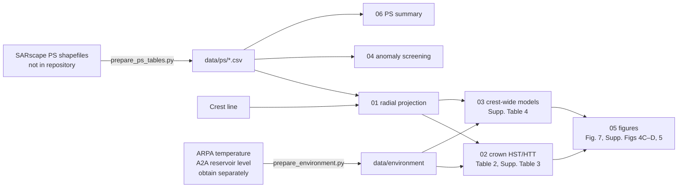

# Sentinel-1 PS-InSAR monitoring of the Cancano II and San Giacomo dams (Italian Alps)

Code and derived data for the study of two operational hydropower dams in the upper Valtellina (Lombardy, Italy) with Sentinel-1 persistent-scatterer interferometry (PS-InSAR), January 2020 – June 2025. The repository reproduces the dam-scale results of the associated manuscript:

- **Radial projection** of ascending line-of-sight (LOS) displacement onto the local crest normal of the Cancano II arch-gravity dam.
- **HST and HTT models** (hydrostatic–seasonal–time and hydrostatic–temperature–time) fitted to the three crown PS, with an independent temporal validation, a linear-trend baseline, Newey–West confidence intervals and residual diagnostics.
- **Sensitivity tests** for delayed thermal response (running-mean air temperature) and reservoir-level hysteresis (30-day reservoir rate).
- **Crest-wide representativeness** of the crown result (all 62 ascending PS with a valid projection).
- **Anomaly screening** of a descending-LOS cluster whose rate equals one phase cycle per year (λ/2 = 27.7 mm yr⁻¹).

> **Associated manuscript (in preparation):** Neupane, B. *et al.* Screening operational Alpine dams with Sentinel-1 PS-InSAR: anomaly control and hydrostatic–thermal modelling at Cancano II and San Giacomo, Italy. The citation will be updated on publication.

---

## Study sites

| Dam | Type | Crest | Sentinel-1 PS on the dam |
|---|---|---|---|
| Cancano II (1953–1956) | Single-curvature arch-gravity | ≈381 m, ≈1900 m a.s.l. | 65 ascending, 59 descending, 16 shape-combination |
| San Giacomo (1940–1950) | Concrete buttress | ≈375 m | 173 ascending, 319 descending, 8 shape-combination |

Sentinel-1 IW SLC, VV, 66 ascending (track 15) and 66 descending (track 168) acquisitions, about one per month, processed with ENVI SARscape (PS module).

## Workflow



## Repository structure

```
├── data/
│   ├── ps/                      PS attribute tables and LOS time series (both dams, both tracks)
│   ├── geometry/                Cancano II crest line (EPSG:32632)
│   ├── environment/             (empty) place the temperature and reservoir records here
│   └── README.md                provenance, licence and column definitions
├── src/cancano_ps/              geometry, models, anomaly screening, input/output, settings
├── scripts/                     numbered analysis steps + two data-preparation scripts
├── results/
│   ├── radial/                  radial displacement series of every PS
│   ├── tables/                  Table 2, Supplementary Tables 3–4, screening and summary tables
│   ├── models/                  observed and predicted crown series
│   └── figures/                 Figure 7, Supplementary Figures 4C–D and 5
├── docs/                        detailed methods (column definitions are in data/README.md and results/README.md)
├── tests/                       unit tests (sign conventions, estimation, screening)
└── run_all.py                   runs the analysis steps in order
```

## Quick start

```bash
git clone https://github.com/Vashudeva/alpine-dams-psinsar-hst-htt.git
cd alpine-dams-psinsar-hst-htt
python -m venv .venv && source .venv/bin/activate      # Windows: .venv\Scripts\activate
pip install -r requirements.txt
python run_all.py
pytest
```

Without the environmental records, `run_all.py` runs the radial projection, the anomaly screening, the PS summary and the figures that need only PS data. To reproduce the HST/HTT results, obtain the two records described in [`data/environment/README.md`](data/environment/README.md), then run

```bash
python scripts/prepare_environment.py --arpa <ARPA export.csv> --a2a <A2A reservoir.csv>
python run_all.py
```

## Main results reproduced by the code

Radial displacement is positive downstream. Calibration: 8 Jan 2020 – 4 Apr 2024 (n = 52); validation: 10 May 2024 – 10 Jun 2025 (n = 14).

| Crown PS | HST val. R² | HTT (same-day T) val. R² | HTT (45-day mean T) val. R² | HST annual amplitude | Most upstream | ΔAICc HST vs linear trend |
|---|---|---|---|---|---|---|
| CrPS1 (PS 23) | 0.75 | 0.53 | 0.80 | 18.0 mm | day 240 | −28.3 |
| CrPS2 (PS 24) | 0.70 | 0.52 | 0.76 | 17.1 mm | day 242 | −31.6 |
| CrPS3 (PS 25) | 0.21 | 0.09 | 0.22 (75-day) | 9.9 mm | day 237 | +2.4 |

The annual air-temperature maximum falls on day 205, so the crown reaches its most upstream position 35–37 days later. The full tables are in [`results/tables`](results/tables).

## Sign conventions

- **LOS** displacement is positive towards the satellite.
- **ALOS** is the SARscape look azimuth, measured from the sensor towards the target; **ILOS** is the incidence angle.
- The ground-to-satellite unit vector is ĝ = (−sin ILOS sin ALOS, −sin ILOS cos ALOS, cos ILOS) in (east, north, up).
- **Radial** displacement is d_R = d_LOS / (ĝ·n̂), with n̂ the horizontal crest normal pointing downstream, so positive values are downstream. Projections with |ĝ·n̂| < 0.15 are rejected.

Because the projection assumes horizontal motion, 1 mm of crest uplift appears as about 2 mm of upstream radial displacement at the crown. See [`docs/methods.md`](docs/methods.md).

## Data availability

| Data | In repository | Source and licence |
|---|---|---|
| PS attributes and LOS time series of both dams | Yes, `data/ps` | Derived from Copernicus Sentinel-1 data (2020–2025), processed by the authors; CC BY 4.0 |
| Cancano II crest line | Yes, `data/geometry` | Digitised by the authors; CC BY 4.0 |
| Daily air temperature, Valdidentro Cancano station | No (link) | ARPA Lombardia open data |
| Daily reservoir elevation of Cancano II | No | A2A; available on request from A2A |
| Full-scene SARscape and EGMS products (≈12 GB) | No | Available from the authors on request |

## How to cite

If you use this repository, cite the associated article (when published) and the repository itself; see [`CITATION.cff`](CITATION.cff).

## Licence

- **Code** (`src/`, `scripts/`, `tests/`, `run_all.py`): [MIT](LICENSE).
- **Data and results** (`data/`, `results/`): [CC BY 4.0](data/LICENSE).

## Acknowledgements

Copernicus Sentinel-1 data (ESA/European Commission). Air-temperature data: ARPA Lombardia (HydroNivoMeteo network). Reservoir levels: A2A. This work was part of PhD research at the University of Rome Tor Vergata under Ministerial Decree (DM) 118/2023 of the Italian Ministry of University and Research (MUR).
